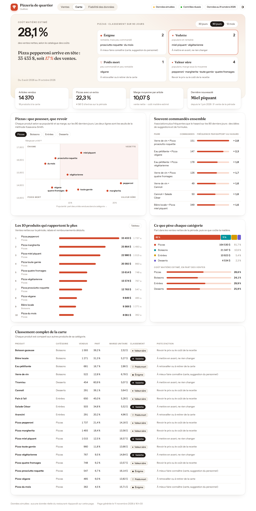
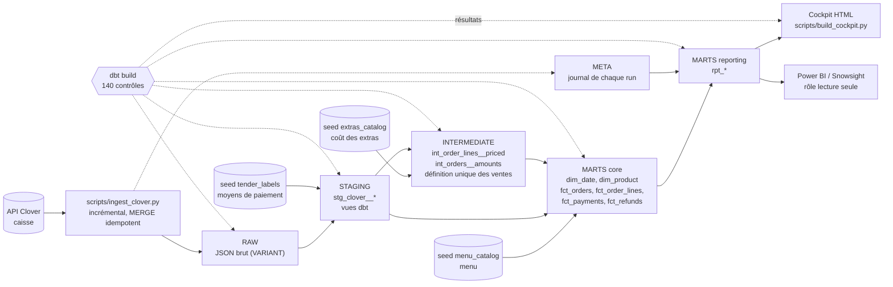
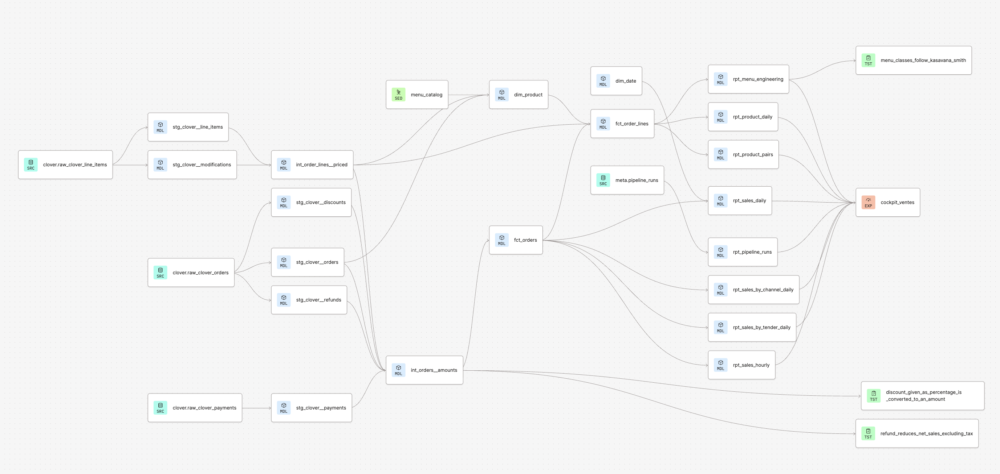
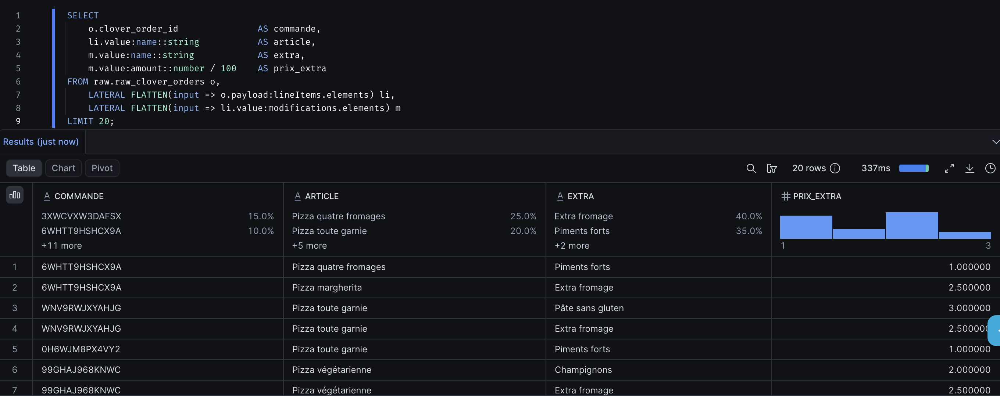
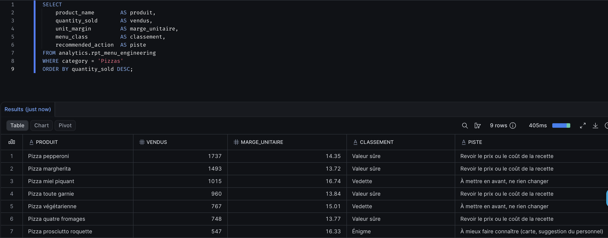

# Attaboy — de la caisse au tableau de bord

[](https://github.com/OtmaneZ/attaboy-data-pipeline/actions/workflows/ci.yml)

Pipeline de données et cockpit des ventes d'**Attaboy, pizzeria de quartier** (Québec, rue Saint-Jean). Les ventes de la caisse Clover sont chargées chaque jour dans Snowflake, transformées et testées avec dbt, puis publiées dans une page que le propriétaire ouvre sur son téléphone.


> **Où en est le projet** : démonstration complète sur des **données simulées**, en local et sur Snowflake. La mise en service avec les ventes réelles du restaurant est l'étape suivante (voir [État](#état)). Toutes les captures de ce dépôt montrent des données simulées ; aucune donnée réelle du restaurant n'est versionnée.

## Voir le projet tourner en une minute

Aucun compte, aucun secret : la démo s'exécute en local sur DuckDB avec deux ans de commandes fictives.

```bash
git clone https://github.com/OtmaneZ/attaboy-data-pipeline.git && cd attaboy-data-pipeline
make install    # environnement Python + dbt
make demo       # données simulées → dbt build (modèles + tests) → cockpit
```

Le cockpit est dans `cockpit/dist/index.html` : un seul fichier, à ouvrir dans un navigateur.

## Ce que le propriétaire y trouve

| Onglet | Questions auxquelles il répond |
|---|---|
| **Ventes** | Combien ai-je vendu, par rapport à la période précédente ? Quels jours et quelles heures sont les plus chargés ? Quelle part pour la livraison ? |
| **Carte** | Quels produits rapportent le plus ? Lesquels pousser, revoir ou retirer ? Quels produits se vendent ensemble ? |
| **Fiabilité des données** | Les chiffres sont-ils à jour ? Quels contrôles ont tourné ? Comment chaque chiffre est-il défini ? |

| Carte | Fiabilité des données |
|---|---|
|  |  |

## Architecture



- **Incrémental et idempotent** : chaque run relit les commandes modifiées depuis le début du dernier run réussi, puis fait un `MERGE` dédoublonné dans une transaction. Relancer un run ne crée jamais de doublon.
- **Chargement adapté au volume** : INSERT par lots pour un run quotidien ; au-delà de 5 000 lignes, un fichier envoyé d'un coup (`PUT`) puis lu par Snowflake (`COPY INTO`). Deux ans de démonstration, soit 174 000 lignes, se chargent en 45 secondes.
- **Deux cibles, les mêmes modèles** : `snowflake` pour le projet, `local` (DuckDB) pour la démo, le développement et la CI. Six macros isolent les différences de syntaxe.
- **Sécurité** : compte de service avec paire de clés RSA, rôles séparés écriture / lecture, secrets uniquement dans un `.env` hors du dépôt, champs libres de la caisse confinés au schéma `RAW`.
- **Coûts maîtrisés** : warehouse XS en veille après 60 s, plafond de 10 crédits par mois, cockpit consultable sans rallumer l'entrepôt. Détail dans [docs/couts.md](docs/couts.md).

Les choix et leurs raisons : [docs/decisions.md](docs/decisions.md).

## Modèle de données



| Couche | Modèles | Rôle |
|---|---|---|
| `staging` | `stg_clover__orders`, `__line_items`, `__payments`, `__modifications`, `__discounts`, `__refunds` | Noms clairs, heure du restaurant, extras, rabais et remboursements dépliés depuis le JSON |
| `intermediate` | `int_order_lines__priced`, `int_orders__amounts` | La définition unique des ventes : brut, rabais, taxes, pourboires, remboursements |
| `marts/core` | `dim_date`, `dim_product`, `fct_orders`, `fct_order_lines`, `fct_payments`, `fct_refunds` | Modèle en étoile : une ligne par commande, par article, par paiement et par remboursement |
| `marts/reporting` | `rpt_sales_daily`, `rpt_sales_hourly`, `rpt_sales_by_channel_daily`, `rpt_sales_by_tender_daily`, `rpt_payments_daily`, `rpt_product_daily`, `rpt_menu_engineering`, `rpt_product_pairs`, `rpt_pipeline_runs` | Tables prêtes à lire : rapport quotidien, affluence, caisse par moyen de paiement, analyse de la carte, associations de produits |

Documentation dbt en ligne (chaque modèle, chaque colonne, la lignée et les contrôles), régénérée sur les données simulées à chaque push sur `main` : https://otmanez.github.io/attaboy-data-pipeline/

## Dans Snowflake

Les mêmes modèles tournent dans Snowflake. Deux requêtes de la [visite guidée](sql/100_visite_guidee.sql), exécutées dans Snowsight sur les données simulées :

| Le JSON brut de la caisse, déplié | La table que lit l'onglet Carte |
|---|---|
|  |  |

À gauche, `LATERAL FLATTEN` sort les articles et leurs extras de la colonne `payload` (schéma `RAW`). À droite, `rpt_menu_engineering` (schéma `ANALYTICS`) donne pour chaque pizza son classement et la piste d'action associée.

## Qualité

Chaque exécution lance 140 contrôles dbt ; un seul échec arrête le pipeline avant le cockpit.

- **Règles métier** : le total recalculé de chaque commande retombe sur celui de la caisse au cent près ; les paiements couvrent le total ; la somme des articles redonne la commande ; le rapport quotidien ne perd aucune vente ; paiements moins remboursements redonnent le montant encaissé de chaque commande.
- **Tests unitaires dbt** : conversion d'un rabais en pourcentage, part hors taxes d'un remboursement, prix et coût des extras, commande passée après minuit, remboursement rendu un autre jour, classement de la carte (méthode Kasavana-Smith) sur un cas d'école.
- **Structure** : clés uniques et non nulles, relations entre tables, valeurs autorisées, fraîcheur des sources.
- **Isolement** : une base ne contient qu'un marchand ; données simulées et réelles ne se mélangent pas.

S'y ajoutent 65 tests unitaires Python (ingest, générateur, chargement local, cockpit, copie pour un nouvel établissement) et une CI GitHub Actions qui rejoue le pipeline complet à chaque push.

## Contenu du dépôt

| Dossier | Rôle |
|---|---|
| `sql/` | Provisioning Snowflake versionné : `000` infra et rôles, `001` tables RAW, `002` tables META, `100` visite guidée de l'entrepôt en dix requêtes, `999` suppression complète |
| `scripts/` | `ingest_clover.py` (ingest), `demo_data.py` (commandes simulées), `local_warehouse.py` (entrepôt DuckDB), `build_cockpit.py` (cockpit), `capture.py` (captures d'écran), `new_client.py` (copie renommée pour un autre établissement) |
| `dbt/` | Modèles, macros, fichiers tenus à la main (`seeds/` : menu, extras, libellés des moyens de paiement), tests |
| `cockpit/` | Gabarit du cockpit et réglages propres au client (`client.json`) |
| `tests/` | Tests unitaires pytest, sans connexion |
| `docs/` | [Décisions](docs/decisions.md), [coûts](docs/couts.md), [reprise pour un autre établissement](docs/nouveau-client.md), captures |

`make` affiche toutes les commandes disponibles.

## Mise en place sur Snowflake

### 1. Snowflake (une fois, avec le rôle ACCOUNTADMIN)

```bash
# Paire de clés du compte de service, sur le serveur
install -d -m 700 /opt/clients/attaboy/keys && cd /opt/clients/attaboy/keys
openssl genrsa 2048 | openssl pkcs8 -topk8 -v2 aes-256-cbc -inform PEM -out snowflake_rsa_key.p8
openssl rsa -in snowflake_rsa_key.p8 -pubout -out snowflake_rsa_key.pub
chmod 600 snowflake_rsa_key.p8
```

Dans Snowsight (Worksheet), exécuter dans l'ordre :

1. `sql/000_bootstrap.sql`
2. `ALTER USER ATTABOY_PIPELINE_SVC SET RSA_PUBLIC_KEY = '<contenu de .pub sans les lignes BEGIN/END>';`
3. `sql/001_schema_raw.sql`, puis `sql/002_schema_meta.sql`

### 2. Serveur

```bash
make install
cp .env.example /opt/clients/attaboy/.env   # puis remplir ; chmod 600
```

### 3. Lancer

```bash
make daily      # ingest Clover → dbt build → cockpit, avec les variables de /opt/clients/attaboy/.env
```

Pour charger les données simulées dans Snowflake plutôt que les ventes réelles :

```bash
set -a; source /opt/clients/attaboy/.env; set +a
.venv/bin/python -m scripts.demo_data --end 2026-10-31 --days 730 --load --replace
```

Les lignes simulées portent le `merchant_id` `DEMOPIZZERIA1` et un `run_id` préfixé `demo-`. `--replace` efface d'abord la démo déjà chargée, et elle seule. Avec la même fenêtre que `make demo`, Snowflake et l'entrepôt local donnent exactement les mêmes chiffres.

Pour faire le tour de l'entrepôt dans Snowsight : [sql/100_visite_guidee.sql](sql/100_visite_guidee.sql).

### Suivi

```sql
SELECT * FROM ATTABOY_DW.META.V_PIPELINE_LAST_RUN;   -- dernier run de chaque pipeline
```

## État

- [x] Ingest Clover → Snowflake (incrémental, idempotent)
- [x] Modèles dbt : étoile des ventes, rapports, analyse de la carte
- [x] Démo locale complète, CI, cockpit des ventes
- [x] Exécution complète sur Snowflake avec les données simulées : deux ans chargés, `dbt build` vert, mêmes chiffres qu'en local au dollar près
- [ ] Ingest réel : élargir les champs demandés à l'API Clover (type de commande, rabais, remboursements, extras)
- [ ] Ingest des factures fournisseurs PDF (Saputo, Colabor) → coûts matière réels à la place du catalogue estimé
- [ ] Orchestration quotidienne (timer systemd, 05:00 heure de l'Est) et alertes Healthchecks.io
- [ ] Passage au compte Snowflake du restaurant

## Réversibilité

`sql/999_teardown.sql` supprime tout ce que le projet a créé dans Snowflake (récupérable pendant 1 jour avec `UNDROP DATABASE`). Les données brutes peuvent être rechargées à tout moment depuis l'API Clover.

## Licence

[MIT](LICENSE). Le nom Attaboy est utilisé avec l'accord du propriétaire.

## In English

- **Problem**: a single-location neighbourhood pizzeria in Québec City has its sales locked in the Clover point of sale and no simple view of what sells, when, and at what margin.
- **Stack**: Python ingestion (Clover API → Snowflake, idempotent `MERGE`), dbt (staging → star schema → reporting, 140 dbt checks and 65 Python tests), DuckDB for the local demo and CI, a static HTML dashboard.
- **What it shows**: a small, fully tested pipeline where every sales figure reconciles to the cent across layers, with the same models running on DuckDB and Snowflake.
- **Try it** (simulated data, no account needed): `make install && make demo`, then open `cockpit/dist/index.html`.
